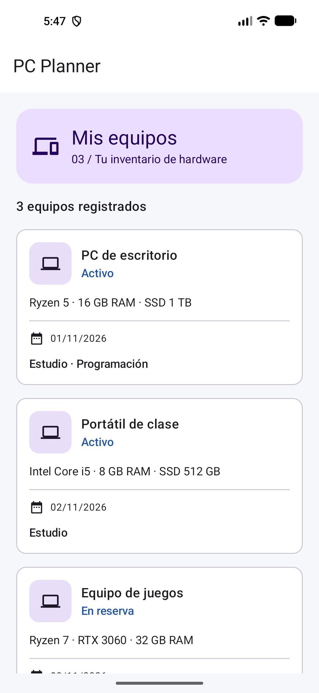
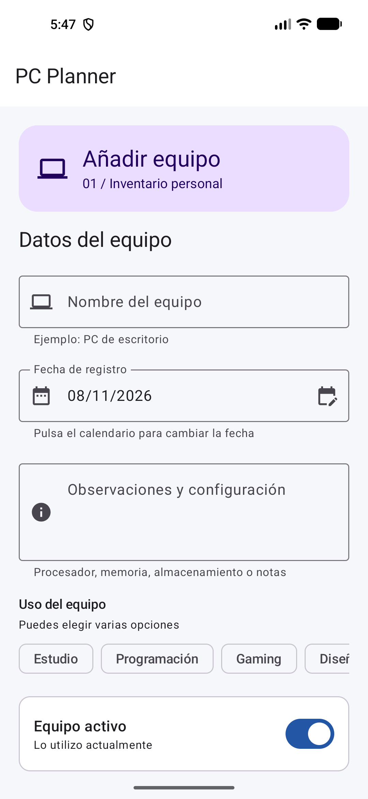
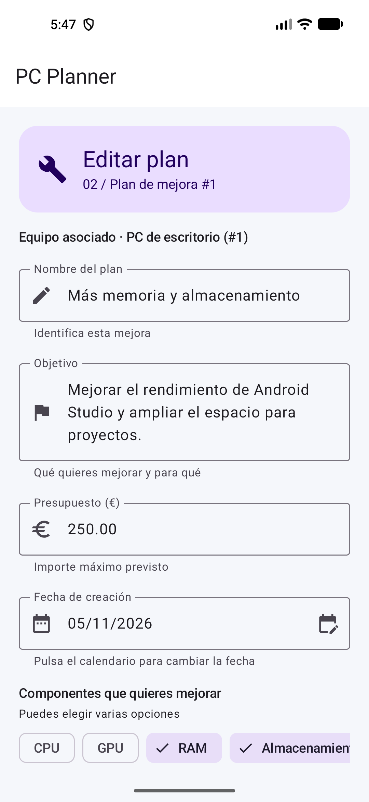

# PC Planner — Tarea 2 de DEINT

Javier Agradano Krasimirova · 2.º DAM · 8 de noviembre de 2026

Diseño de tres pantallas del planificador de mejoras de PC con Kotlin y Jetpack Compose Material 3.

## Alcance de esta entrega

Se sigue la fase estática descrita en Moodle y la indicación de clase confirmada por Javi. Las pantallas son independientes. Los controles permiten editar datos en memoria, abrir el calendario y comprobar validaciones. La aplicación abre el listado con datos ficticios. La navegación entre pantallas y la persistencia se incorporarán en una fase posterior.

El PDF incluye requisitos de una fase más amplia, como Navigation Compose y el paso de un ID. Se ha aplicado el alcance de clase confirmado por el alumno. La edición recibe un `PlanMejora` precargado mediante parámetro.

## Pantallas

| Pantalla | Entidad | Contenido |
|---|---|---|
| Añadir equipo | `equipo` | Nombre, fecha de registro, observaciones/configuración, usos y activo |
| Editar plan | `plan_mejora` | ID, equipo asociado, nombre, objetivo, presupuesto, fecha, estado, categorías y completado |
| Mis equipos | `equipo` | Tres registros ficticios con icono, nombre, configuración, fecha, usos y situación |

Los atributos de la Tarea 1 se mantienen. Los usos/categorías y los booleanos son extensiones de interfaz para cubrir los controles exigidos. En esta entrega no se modifica el esquema SQL anterior. El ID de un alta se reserva como 0 hasta que exista almacenamiento. El plan de prueba pertenece al equipo 1.

## Estructura

```text
app/src/main/java/com/example/pcplanner/
  MainActivity.kt
  model/Models.kt
  ui/theme/PlannerTheme.kt
  ui/components/Components.kt
  ui/equipo/EquipoScreen.kt
  ui/plan/PlanScreen.kt
  ui/listado/ListadoScreen.kt
```

Cada pantalla tiene función `Screen` propietaria de los datos y `Content` que recibe valores y callbacks. Los formularios usan `data class` para estado, eventos y acciones, con actualizaciones mediante `copy()`. Los mensajes de validación se calculan en `Screen`. El estado visual de desplazamiento pertenece al contenedor desplazable.

`FormField`, `DateField`, `MultiSelection`, `ScreenHeader` y `EquipoCard` son reutilizables y tienen documentación KDoc. Las vistas previas incluyen temas claro/oscuro, anchos distintos y datos de prueba. El listado incluye además una preview vacía.

## Ejecutar y revisar

1. Abrir esta carpeta como proyecto en Android Studio y sincronizar Gradle.
2. Seleccionar el dispositivo Pixel 5 y ejecutar `app`.
3. Para visualizar otro formulario, cambiar el valor por defecto de `pantalla` en `MainActivity` de `"listado"` a `"equipo"` o `"plan"`.
4. También se pueden abrir directamente `EquipoPreview`, `PlanPreview`, `ListadoPreview` y `ComponentsPreview` en Android Studio.

El calendario se abre desde el icono del campo de fecha. Los chips de usos y componentes permiten marcar varias opciones. El estado de un plan utiliza una sola opción y se mantiene coherente con «Mejora completada».

Al pulsar guardar se comprueban nombre y selección en el alta. En la edición se comprueban nombre, objetivo, presupuesto positivo con hasta dos decimales y categorías. Los errores se muestran junto a los controles y se actualizan al corregirlos. Un mensaje indica que el formulario se ha validado localmente.

## Capturas del emulador

Las imágenes se incluyen en `docs/capturas`.

| Listado | Alta | Edición |
|---|---|---|
|  |  |  |

## Decisiones de diseño

- Jerarquía con cabecera, secciones y acción principal al final del formulario.
- Formularios desplazables para pantallas pequeñas y contenido de varias líneas.
- Etiquetas permanentes, iconos significativos y ayuda bajo cada campo.
- Colores Material 3, superficies y contraste adaptados al tema.
- `LazyRow` para colecciones seleccionables y `LazyColumn` para el inventario.
- Validación de fecha en milisegundos UTC y presentación española para evitar cambios de día por huso horario.

## Referencias de estudio

Se han seguido el patrón de estado/eventos/acciones de las clases del 27 y 29 de octubre, los formularios del 30 de octubre, la selección del 3 de noviembre y el listado del 5 de noviembre. La copia de Moronlu contiene las lecciones «Estado y recomposición», «Hoist State», «Componentes Interactivos» y «Lista desplazable».

- [Estado en Compose](https://developer.android.com/develop/ui/compose/state)
- [Listas en Compose](https://developer.android.com/develop/ui/compose/lists)
- [DatePicker](https://developer.android.com/develop/ui/compose/components/datepickers)
- [Previews](https://developer.android.com/develop/ui/compose/tooling/previews)
- [Lint](https://developer.android.com/studio/write/lint)

Este README está preparado para incorporarse al repositorio de GitHub de la entrega.

## Comprobaciones

Layout Inspector se utilizó en las tres pantallas. Véanse [procedimiento, solución de compatibilidad y evidencias](docs/verificacion/LAYOUT_INSPECTOR.md). Se utiliza Compose BOM 2026.04.01 / UI 1.11.0.

Compilación y Lint finalizados correctamente. Las pruebas de calendario, validación y corrección de selección se detallan en `docs/verificacion/COMPROBACIONES.md`. El informe de Lint se incluye en esa carpeta. Las capturas corresponden a la aplicación ejecutándose en el Pixel 5. Se ejecutó `clean` antes de empaquetar.
