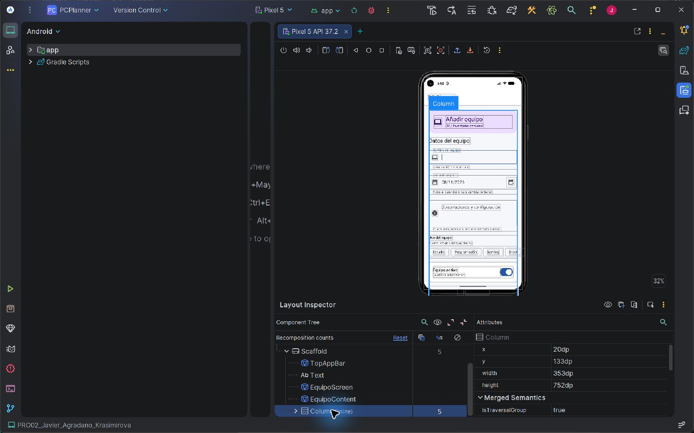
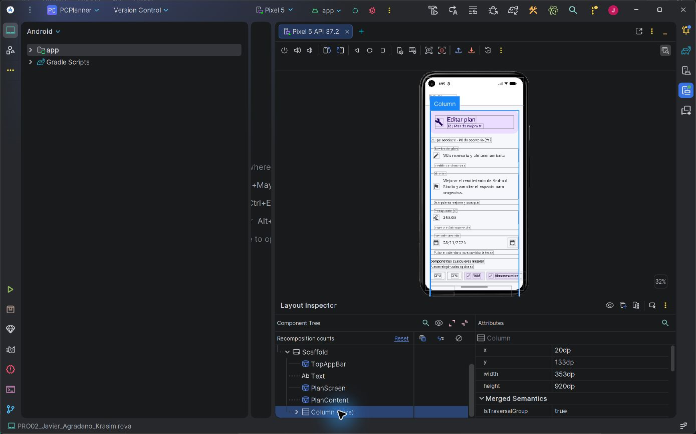

# Revisión con Layout Inspector

8 de noviembre de 2026 · Android Studio · Pixel 5 API 37.2.

Con Compose UI 1.10.4, Android Studio mostraba un aviso de posible fallo y el árbol quedaba vacío. Se actualizó el BOM de 2026.02.01 a 2026.04.01, que resuelve UI 1.11.0. Tras compilar e instalar, el inspector cargó el árbol y los atributos. Se repitieron assembleDebug y lintDebug correctamente.

## Observaciones

- Listado: PlannerTheme > MaterialTheme > Scaffold > ListadoScreen > ListadoContent > LazyColumn. Su selección mostró x=0 dp, y=113 dp, ancho=393 dp y alto=713 dp, bajo la barra superior.
- Alta: EquipoScreen > EquipoContent > Column. x=20 dp, y=133 dp, ancho=353 dp y alto=752 dp. Se observaron campos, chips, switch y márgenes laterales. El formulario dispone de desplazamiento.
- Edición: PlanScreen > PlanContent > Column. x=20 dp, y=133 dp, ancho=353 dp y alto=920 dp. El formulario supera el viewport y se desplaza para acceder a sus controles inferiores.

Las dimensiones corresponden al Pixel utilizado, no son valores fijos del diseño. No se realizó un perfil de rendimiento. Las capturas registran el árbol y los atributos seleccionados.

## Repetir

Ejecutar la app y abrir Layout Inspector con Ctrl+Mayús+A. Seleccionar el contenedor en Component Tree y revisar Attributes. Las pantallas se ejecutan de manera independiente según el README; no se ha añadido navegación.

Referencia: [Depuración Compose](https://developer.android.com/develop/ui/compose/tooling/debug).
